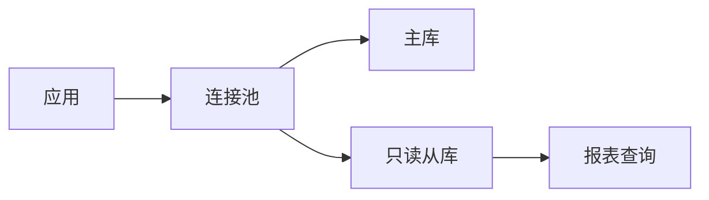
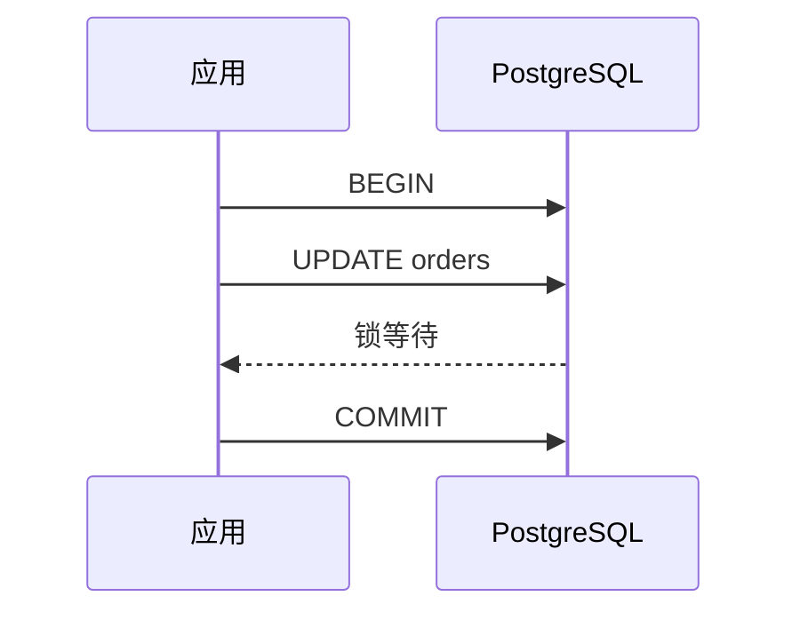

这一页用来验证三类组件是否正常，同时作为写法参考。源码见 `source/examples/index.md`。

## 数学公式

行内公式直接写在句子里，例如质能方程 $E = mc^2$，带下标的 $a_0$ 与下标相连的 $a_0 x$。

行间公式单独成段：

$$
\int_0^\infty e^{-x^2}\,dx = \frac{\sqrt{\pi}}{2}
$$

$$
\sum_{i=1}^{n} i = \frac{n(n+1)}{2}
$$

带分数的行内式子 $\frac{a}{b}$ 与上下标 $x_i^2$ 也能正常显示。

## Mermaid 图表

用 `mermaid` 语言的代码块书写，主题会在浏览器端渲染成图。

时序图：

## 时间线

静态时间线把节点写在正文里，用 `<!-- node 标题 -->` 分隔。


<!-- node 2026-10-05 -->
连接数打满时先看这三件事：连接泄漏、空闲事务、真实并发。
<!-- node 2026-10-08 -->
一条慢查询的定位过程：先用 pg_stat_statements 找到语句，再用 EXPLAIN 看清瓶颈。
<!-- node 2026-10-12 -->
索引没生效的几种常见原因：列顺序、隐式类型转换、对列做运算、选择性问题、统计信息过期。


## 相关配置

| 组件 | 配置位置 | 说明 |
| --- | --- | --- |
| 公式 | `_config.stellar.yml` 的 `features.math` | `provider` 需保持 `null`，由 `scripts/math-protect.js` 处理并注入 MathJax |
| 图表 | `_config.stellar.yml` 的 `features.diagrams` | `provider: mermaid`，由 `scripts/mermaid-blocks.js` 转换成主题识别的容器 |
| 时间线 | 无需配置 | 主题内置标签，直接写在 Markdown 里 |
