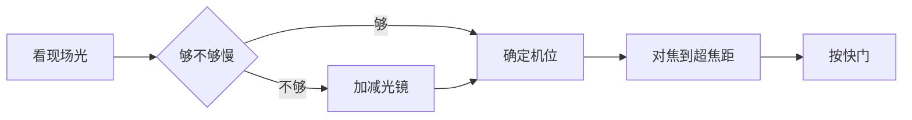
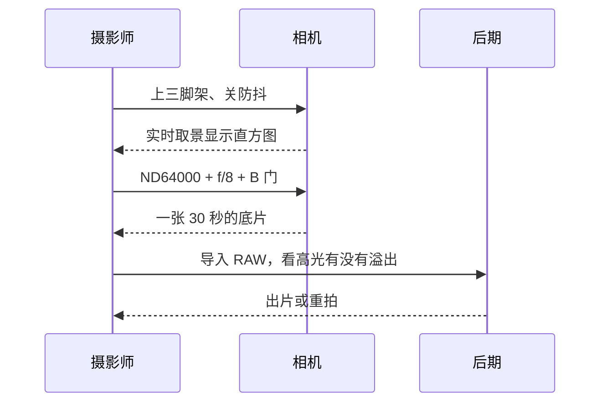

这一页用来验证三类组件是否正常，同时作为写法参考。源码见 `source/examples/index.md`。
示例内容按摄影主题写，这样它既是一张测试页，也能当成随手的备忘。

## 数学公式

行内公式直接写在句子里。按互易律，光圈从 $f/8$ 收到 $f/16$ 相当于少两档光，快门要慢 $2^2 = 4$ 倍：

$$
t' = t \times 2^{\Delta EV}
$$

用 ND64000 这样的减光镜时，先查它是多少档，再往慢里数。常见的 10 档减光镜可以把 $1/125$ 秒推到 $8$ 秒左右。行内下标与分数也没问题，例如 $a_0$ 与紧邻下标的 $a_0 x$、$\frac{1}{125}$ 秒。

行间公式单独成段，超焦距的经典近似式：

$$
H = \frac{f^2}{N c} + f
$$

其中 $f$ 是焦距、$N$ 是光圈值、$c$ 是容许弥散圆直径。以 $\,f = 24\,\text{mm}$、$N = f/8$、$c = 0.03\,\text{mm}$ 估算，超焦距约 $2.4$ 米；对焦在超焦距上，从大约一半的距离到无穷远都在景深内。带花括号的求和式同样正常：

$$
\sum_{k=0}^{n} 2^{k} = 2^{n+1} - 1
$$

## Mermaid 图表

用 `mermaid` 语言的代码块书写，主题会在浏览器端渲染成图。

时序图：

## 时间线

静态时间线把节点写在正文里，用 `<!-- node 标题 -->` 分隔。


<!-- node 2026-09-13 -->
第一次用 ND64000 在汉口江滩拍长曝光，30 秒就能把船灯拉成光带。
<!-- node 2026-09-20 -->
发现没关防抖，长曝光边缘有轻微重影；下一组开始上三脚架并关掉防抖。
<!-- node 2026-10-05 -->
开始记拍摄参数：光圈、快门、ISO、减光镜档数，后期时能对着复现。


## 相关配置

| 组件 | 配置位置 | 说明 |
| --- | --- | --- |
| 公式 | `_config.stellar.yml` 的 `features.math` | `provider` 需保持 `null`，由 `scripts/math-protect.js` 处理并注入 MathJax |
| 图表 | `_config.stellar.yml` 的 `features.diagrams` | `provider: mermaid`，由 `scripts/mermaid-blocks.js` 转换成主题识别的容器 |
| 时间线 | 无需配置 | 主题内置标签，直接写在 Markdown 里 |

改完公式或图表的构建脚本后，记得重新构建并打开这一页确认三类组件都还正常；`tools/check-site.mjs` 会检查这一页的产物是否存在。
